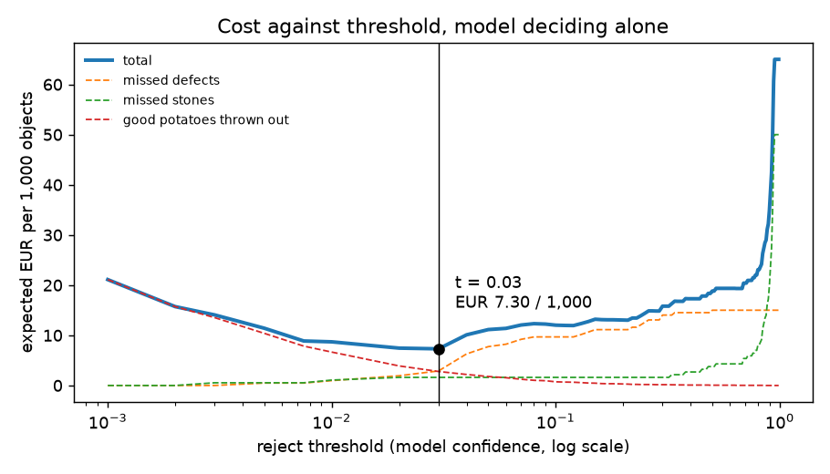

# Assignment 2 Report

- **Name**: Paul Khairallah
- **Student ID**: 18966
- **Email**: pkhairallah.ieu2022@student.ie.edu
- **Group**: BBADBA 5B

## Business problem, and the cost of being wrong

**The decision.** A potato packer washes potatoes and runs them over a roller
conveyor into 2.5 kg retail bags. Today two or three people stand at a picking
table and pull out rotten or blemished potatoes and stones by eye. The model
replaces their eyes: a camera above the rollers scores every object on the belt,
and each object either **passes**, is **ejected** by an air jet into the reject
stream, or is diverted to a short **review belt** where one person looks at it.
The unit of decision is one object on the belt, not one image.

**What each mistake costs.**

| Outcome | What happens | Cost | Where the figure comes from |
|---|---|---|---|
| Missed defect (FN) | A rotting or blemished potato goes into a bag. Rot spreads in the bag, the customer complains, the retailer charges the packer back. | €1.50 | Roughly the packer's selling price of the 2.5 kg bag it spoils, i.e. the chargeback when the bag is refunded. |
| Missed stone (FN) | A stone goes into a bag (foreign-body complaint) or into a downstream peeler/cutter. | €25 | A foreign-body complaint triggers a written investigation and often a credit on the whole delivery; a chipped peeler knife alone costs more than this. Deliberately conservative. |
| Good potato rejected (FP) | A sellable ~200 g potato goes to the stock-feed stream. | €0.08 | ~€0.40/kg packer value of table potatoes, net of the few cents feed is worth. For comparison, Wageningen's study of the EU frozen-potato sector puts processing potatoes at €13–14 per 100 kg under normal market conditions (https://edepot.wur.nl/553612), so this is an upper-end figure. |
| Correct reject (TP) | A bad potato or stone is removed. | €0 | It was never sellable; the air jet itself costs nothing meaningful. |
| Correct pass (TN) | — | €0 | |
| Human review | One person inspects one diverted object. | €0.025 | 3 seconds at ~€30/h fully loaded labour. |

**The asymmetry.** Missing a defect costs about **19×** a false reject
(€1.50 / €0.08), and missing a stone about **300×**. Every downstream choice
follows from that: the threshold should sit low, recall on `bad` and `stone`
matters far more than precision, and the review band should catch the
borderline cases that are cheap to look at and expensive to miss.

**Base rates.** I assume **1% of objects are defective potatoes** and **0.2% are
stones**. The 1% is what the test belt itself shows (31 defective potatoes out of
~2,950). The test belt has 93 stones (3%), but they sit in only 8 of 99 frames,
about a dozen per frame, which looks like a seeded batch rather than normal
flow; after a destoner and washer, stones should be much rarer, so I use 0.2%
and test the answer against 0.05% and 1% below.

**Line assumptions** for staffing: 10 t/h (~50,000 objects/h at ~200 g), two
8-hour shifts. Commercial optical sorters run 30–100 t/h, so this is a small line.

## Dataset

- **Roboflow Universe:** workspace `ms-workspace-m1gci`, project
  `potato-sorting-on-conveyor`, **version 9**
  (https://universe.roboflow.com/ms-workspace-m1gci/potato-sorting-on-conveyor/dataset/9),
  CC BY 4.0. Downloaded as is in YOLOv11 format; not forked.
- **What one image is:** a 512×512 top-down frame of potatoes on a roller
  conveyor, ~30 objects per frame. Two conveyor cameras (file prefixes
  `kartoffel_auto` and `BELANA_auto`) plus ~50 web/phone photos in train.
- **Classes:** `potato` (every potato), `bad` (a box around a rot/blemish spot
  **on** a potato; the potato itself is also boxed as `potato`), `stone`, and
  `cut` (a cut-open potato; almost all from web photos).
- **Why it serves the problem:** it is the actual sorting scene, the actual
  camera geometry, and the two things a sorter removes (defects and stones),
  rather than studio photos of single potatoes. Because `bad` marks the spot, not
  the potato, I turn detections into one decision per object: a potato is
  "defective" if a `bad` box sits inside it, and its reject score is the
  confidence of the most confident predicted `bad`/`cut` box inside it (or of an
  overlapping predicted `stone` box).

## What the dataset's composition implies

| Split | Images | potato | bad (images with) | stone (images with) | cut |
|---|---|---|---|---|---|
| train | 3,012 (≈1,004 originals × 3 augmented copies) | 84,514 | 1,160 (772) | 2,075 (279) | 176 |
| valid | 121 | 3,763 | 58 (30) | 43 (9) | 10 |
| test | 99 | 2,953 | 29 (21) | 93 (8) | 3 |

Object size (side of the box ÷ side of the image, median): potato 0.10–0.11
(~55 px), stone ~0.09, but **bad only 0.026–0.033 (~13 px)**, and the smallest
10% of blemishes are under 6 px. Version 9 is pre-processed (contrast
stretching, 512×512 stretch) and its training split carries Roboflow's
augmentations (±15% brightness, 90° rotations, ±15° rotation).

What this implies:

1. **The positive classes are the thin ones.** 29 `bad` instances and 3 `cut`
   instances in test. A recall measured on 29 objects has a 95% interval about
   ±17 points wide, so I report Wilson intervals and do not trust any
   difference of a few points. Nothing at all can be concluded about `cut`.
2. **Stones are clustered.** 93 test stones in 8 frames. Stone recall is really
   measured on 8 scenes, not 93 independent events.
3. **Blemishes are tiny.** At ~13 px they sit at the edge of what a YOLO
   detector resolves at 512 px input, which is why I train at 640 (upsampling
   gives the spots more pixels) and why I expect `bad` to be the class that
   drags.
4. **The test split is not an honest stand-in for production.** The conveyor
   frames carry capture timestamps: **94 of the 99 test frames were taken
   within 2 seconds of a training frame** (median gap 0.56 s), on the same two
   days. They show the same potatoes on the same belt from almost the same
   position. Test scores will therefore be optimistic about a new day, a new
   batch or a new camera. The assignment asks me to use the split as published,
   so I keep it, but every number below should be read as "on frames very like
   training", not as a production estimate.

## Finetuning and baselines

**Model and task.** Object detection, `yolo11s` finetuned from the COCO
checkpoint. Detection rather than classification because a frame holds ~30
objects and the sorter has to act on each one, and because the defect label is a
small spot on a potato, which a whole-image classifier could not localise.
`yolo11s` rather than `yolo11n` because the bottleneck is ~13 px blemishes and
the extra capacity is cheap on a GPU.

**Where and how it was trained.** Google Colab, one Tesla T4, via
`colab/train_on_colab.ipynb`, which clones this repo and runs
`python main.py train` unchanged. Settings (all in `TRAIN_CFG` in `train.py`):
60 epochs, imgsz 640, batch 32, optimizer auto (AdamW, lr 0.00125), mosaic
off for the last 10 epochs, extra vertical flips (top-down camera), seed 0,
deterministic. 60 epochs took 47 minutes. The best checkpoint (epoch 48, val
mAP50 0.662 / mAP50-95 0.552) is committed as `weights/potato_yolo11s.pt`. The
evaluation below was re-run on CPU from those committed weights and reproduces
the test numbers Colab printed (mAP50 0.617, mAP50-95 0.501).

**Results on the same test split (99 images).**

| Model | mAP50 | mAP50-95 | Class-agnostic AP50 (finds the objects at all?) | As a sorter at its best threshold, € per 1,000 objects |
|---|---|---|---|---|
| Finetuned yolo11s | **0.617** | **0.501** | 0.995 | **€7.30** (model alone) / **€6.61** (with review) |
| COCO yolo11s zero-shot | 0.000 | 0.000 | 0.441 | €65.00 (never rejects anything) |
| Predict nothing | 0.000 | 0.000 | 0.000 | €65.00 |

The COCO model scores zero on every class by construction: it has no potato,
stone or blemish class. To give it a fair hearing I also scored it
class-agnostically. It does find 94% of the objects at some confidence, but at
conf 0.25 it calls them `elephant` (11), `hot dog` (7), `knife` (5) and `spoon`
(1). It has no label that means "remove this", so as a sorter it is identical to
doing nothing. The finetuned model beats both baselines by a wide margin, which I
expected; what I did not expect was how badly the blemish class does at box
level (next section) while still being useful for the decision.

## Per-class evaluation and failure modes

Positive class for the decision: **`bad` and `stone`** (things to remove);
`potato` is the negative. `cut` is also a reject reason but has 3 test
instances, so I report it and draw no conclusion from it.

| Class | Test instances | Precision | Recall | AP50 | AP50-95 |
|---|---|---|---|---|---|
| potato | 2,953 | 0.989 | 0.998 | 0.995 | 0.971 |
| stone | 93 (8 images) | 0.912 | 0.968 | 0.972 | 0.884 |
| bad | 29 (21 images) | 0.289 | 0.103 | 0.120 | 0.033 |
| cut | 3 | 0.565 | 0.333 | 0.382 | 0.118 |
| **all (mean)** | | 0.689 | 0.601 | **0.617** | **0.501** |

(P and R are Ultralytics' values at the confidence that maximises F1.)

Box-level confusion matrix at conf 0.25 (rows predicted, columns true):

| | true bad | true cut | true potato | true stone | true background |
|---|---|---|---|---|---|
| pred bad | 3 | 0 | 0 | 0 | 6 |
| pred cut | 0 | 1 | 0 | 0 | 0 |
| pred potato | 1 | 1 | 2,947 | 2 | 29 |
| pred stone | 0 | 0 | 0 | 88 | 10 |
| pred background (missed) | 25 | 1 | 6 | 3 | — |

**Who carries the headline number.** The 0.617 mAP50 is an average of potato
(0.995) and stone (0.972) being nearly solved and `bad` (0.120) being close to
useless *as a box detector*: at conf 0.25 it finds 3 of 29 blemishes. Averaging
hides exactly the class the business case depends on.

**Why it still works as a sorter.** The blemish boxes exist, they are just
under-confident. Scoring each potato by its most confident blemish box, the 31
defective potatoes on the test belt have a median score of 0.048, while 2,251 of
the 2,922 good potatoes score exactly 0 and 90% score below 0.007. The ranking is
good even though the confidences are low, which is why the operating threshold
ends up at 0.03 rather than anywhere near Ultralytics' default 0.25. At 0.25 the
sorter would catch only 16% of defects and cost €14.38 per 1,000.

**Where it breaks.**
- **Tiny blemishes.** `bad` boxes are ~13 px; the misses are the smallest and
  faintest spots, and the model never becomes confident about them.
- **Stray reject boxes.** 109 low-confidence blemish/stone boxes land on no
  object at all (rollers, belt edges, frame borders). They count as false
  ejections in the costing. 10 false stones and 29 extra potato boxes at conf
  0.25 sit on background for the same reason.
- **Stones** are the strong class: 88 of 93 found, 3 missed, 2 called potato.
  But the 93 come from 8 frames, so this is closer to 8 observations than 93.
- **`cut`** is untestable (3 instances) and comes mostly from web photos that
  look nothing like the belt.

## Cost matrix and operating point

Costs and base rates are set out in the first section (missed defect €1.50,
missed stone €25, good potato rejected €0.08, review €0.025; 1% defects, 0.2%
stones). Recalls and false-reject rates are measured per object on the test
belt (31 defective potatoes, 93 stones, 2,922 good potatoes, plus 109 stray
reject boxes counted as false ejections) and then re-weighted to those base
rates, so the cost reflects the assumed production mix, not the test split's
mix:

`cost per object = 1% × (1 − defect recall) × €1.50 + 0.2% × (1 − stone recall) × €25 + 98.8% × false-reject rate × €0.08`

**Sweep.** I swept the reject threshold over 104 values from 0.001 to 0.99
(`artifacts/cost_sweep.csv`, plot below, also in the dashboard).

| Threshold | € / 1,000 | Defect recall | Stone recall | Good potatoes rejected |
|---|---|---|---|---|
| 0.001 | 21.10 | 100% | 100% | 26.7% |
| 0.01 | 8.70 | 93.5% | 97.8% | 8.4% |
| 0.02 | 7.44 | 87.1% | 96.8% | 4.9% |
| **0.03** | **7.30** | **80.6%** | **96.8%** | **3.5%** |
| 0.05 | 11.14 | 48.4% | 96.8% | 2.3% |
| 0.25 | 14.38 | 16.1% | 96.8% | 0.2% |
| 0.50 | 18.82 | 0% | 92.5% | 0.1% |

**Operating point for the model alone: t = 0.03, €7.30 per 1,000 objects**
(missed defects €2.90, missed stones €1.61, good potatoes thrown out €2.79).
Defect recall 80.6% (95% Wilson interval 64%–91%, n = 31); stone recall 96.8%
(91%–99%, n = 93).

**How fragile it is.** The curve is flat between 0.02 and 0.03 (€7.44 vs €7.30)
and steep just above: at 0.05 defect recall falls from 81% to 48% and cost jumps
to €11.14. Each test defect is 3.2 points of recall, so the exact position of
that cliff is not well measured. I would ship 0.03 but expect to move it.

**Which assumption matters most.** Re-running the sweep while moving one
assumption at a time (also in the dashboard and `metrics.json`):

- **Missed-defect cost.** t = 0.03 stays optimal from about €0.49 to €1.64. My
  €1.50 is near the top of that range: if a missed defect really costs more than
  ~€1.70, the best threshold drops to 0.02, and above €3 to 0.0075. Below ~€0.49
  it jumps up to 0.12–0.21.
- **False-reject cost.** t = 0.03 holds from about €0.07 to €0.25. My €0.08 is
  near the bottom: if a thrown-out potato is worth less than ~€0.07 net, the
  threshold drops to 0.02.
- **Defect base rate.** t = 0.03 holds from about 0.33% to 1.2%; above 1.2% it
  drops to 0.02, above 2% to 0.0075, below 0.33% it rises to 0.12.
- **Stone cost** does not move the threshold anywhere between €3 and €60,
  because 90% of stones score above 0.69 and any threshold low enough for
  blemishes already catches them. The stone base rate only matters if stones
  are far more common than assumed: at 1% the threshold drops to 0.0075.

So the answer is driven by the **defect base rate and the ratio of missed-defect
cost to false-reject cost**, and my figures sit close to the edges of the range
where 0.03 is right. The first thing to measure on a real line is the defect rate
and the actual chargeback per bad bag.

## What a person still has to check

**Design.** Pass below **0.02**, send to a person from **0.02 to 0.06**, eject
automatically at **0.06 and above**. I chose the pair by searching all
threshold pairs for the lowest expected cost, subject to the review load fitting
the people available (assumed a reviewer misses 10% of real defects and wrongly
rejects 2% of good potatoes).

On the test belt (object counts):

| Truth | pass | review | reject |
|---|---|---|---|
| good potato (incl. 109 stray boxes) | 2,887 | 87 | 57 |
| defective potato | 4 | 13 | 14 |
| stone | 3 | 0 | 90 |

**Load.** At the assumed mix this sends **3.4% of objects** to a person:
~1,680 per hour, **~26,900 per day** over two shifts. At 3 s each that is
~22 review-hours per day, or **1.9 people on the review belt at any moment**.

**Is that realistic?** Only just, and only because I constrained it. The
unconstrained cheapest band (0.0075 to 0.21) costs less, €5.16 per 1,000, but
sends 10% of objects to a person and needs 5.7 people at once. I assume the line
has 2 people to give (the people at today's picking table, moved to the review
belt), which caps review at 3.6% of objects. The chosen band uses 93% of that
capacity, so there is little slack: on a bad batch the review belt will back up,
and the overflow rule should be "eject", not "pass", because a false reject costs
€0.08 and a missed defect €1.50.

**Priced against the alternatives** (€ per 1,000 objects, and per day at
800,000 objects):

| Policy | € / 1,000 | € / day | People needed at once |
|---|---|---|---|
| Do nothing (no sorting) | 65.00 | ~52,000 | 0 |
| A person checks every object | 33.08 | ~26,500 | ~56 |
| Model alone, t = 0.03 | 7.30 | ~5,840 | 0 |
| **Model + review band (0.02 / 0.06)** | **6.61** | **~5,290** | **1.9** |
| Model + unconstrained band (0.0075 / 0.21) | 5.16 | ~4,130 | 5.7 |

Doing nothing is dominated by missed stones (€50 of the €65). Checking
everything by hand is both expensive and physically impossible at this line
speed. The review band beats the model alone by about €0.70 per 1,000
(~€550 a day) after paying for the two reviewers (€0.84 per 1,000). Most of the
saving comes from sending uncertain good potatoes to a person instead of the
feed stream (false-reject cost €2.79 → €1.59); a few more defects get caught as
well (missed-defect cost €2.90 → €2.56).

## Limitations & next steps

1. **The test split is near-duplicate video of the training belt** (94/99 test
   frames within 2 s of a training frame). Every number above is optimistic for
   a new day, batch or camera. Next: re-split by capture session (hold out whole
   minutes or days), and before go-live run the model shadow-mode on a fresh
   day of production with a person labelling what it would have done.
2. **The threshold rests on 31 defective potatoes.** The recall interval is
   64%–91% and the cost curve has a cliff right above the chosen point. Next:
   collect a few hundred defective potatoes from production and re-run the sweep;
   re-check monthly, since potato variety and storage age shift how blemishes
   look.
3. **Blemishes are too small for confident detection.** Next: label the whole
   defective potato as a class instead of the spot, or add a second-stage
   classifier on 128 px potato crops; train at a higher resolution or with tiling.
4. **Stray reject boxes on rollers and belt edges** (109 on the test belt) cost
   false ejections. Next: mask the regions outside the belt and add background
   frames of an empty belt to training.
5. **The euro figures are my estimates, not measured.** Next: get the packer's
   actual chargeback per complaint, the feed price, and a timed sample of review
   decisions (seconds per item and the reviewer's own error rate).
6. **`cut` is not usable** (3 test instances, mostly web photos). Next: drop it
   from the decision or collect cut potatoes on the real belt.
7. **Stone figures come from 8 frames** and possibly a seeded batch. Next: log
   real stone events from the destoner side to get a true base rate.

## Generative AI use disclosure

I used Claude (Anthropic) throughout this assignment. It wrote the code
(`train.py`, `costing.py`, `app.py`, the Colab notebook), found and downloaded
the dataset, ran the training on Colab and the evaluation, and drafted this
report, including the cost figures, base rates and threshold analysis.
